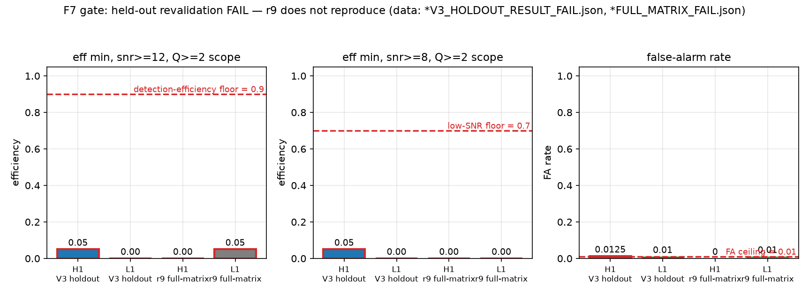
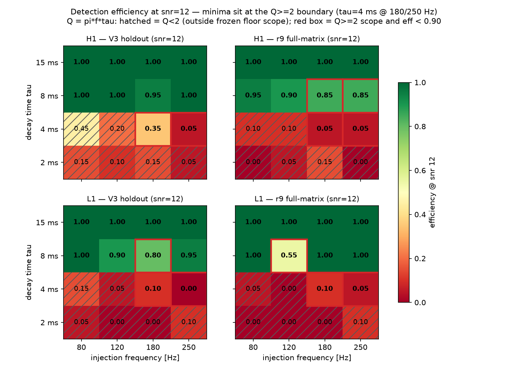
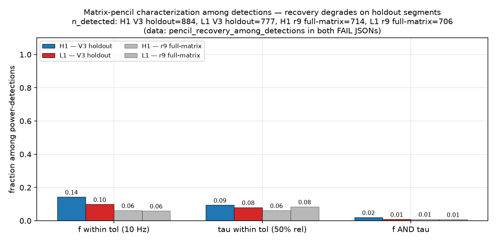
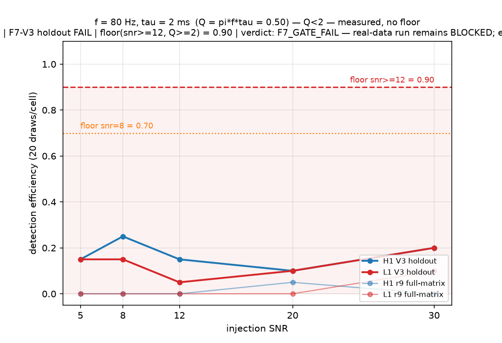
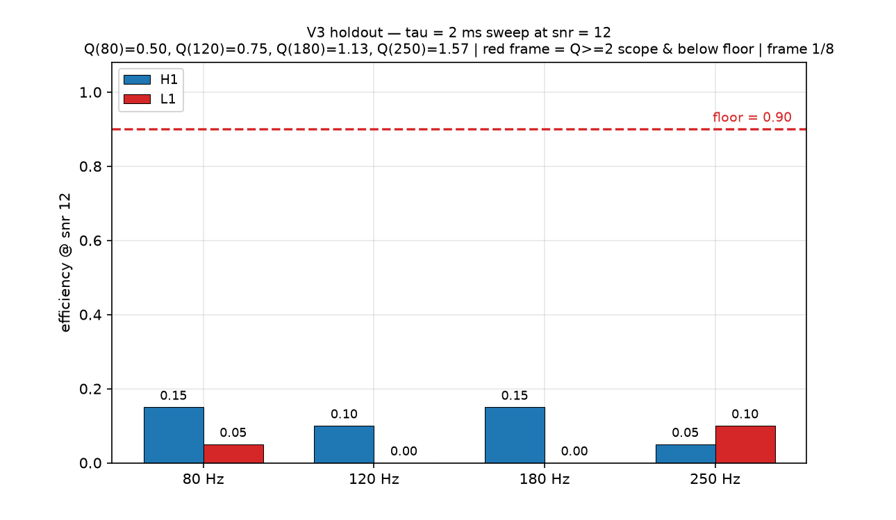
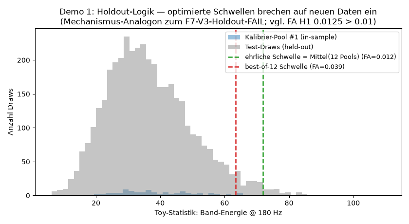
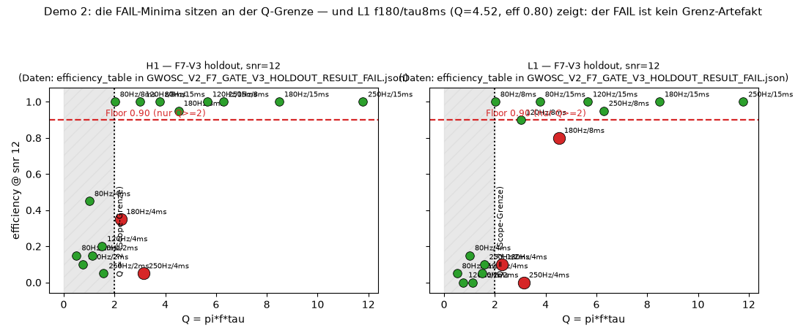
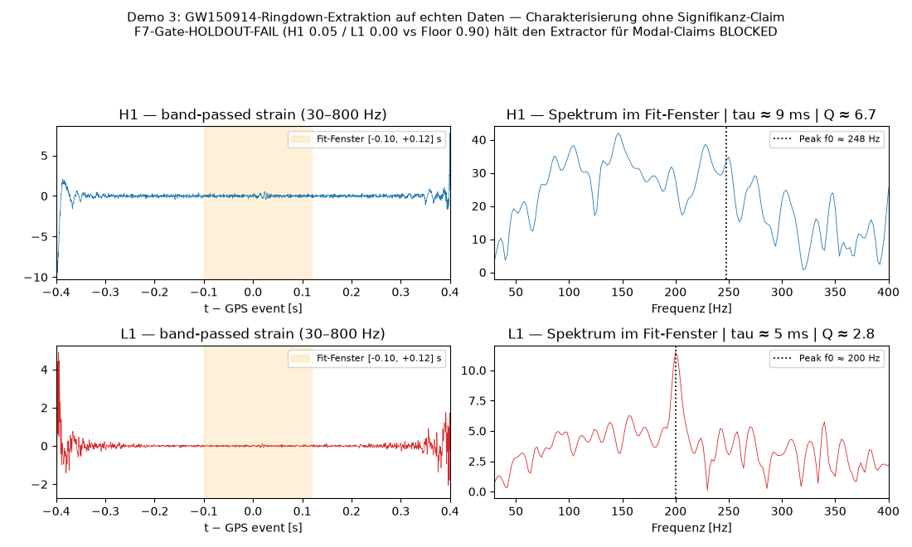
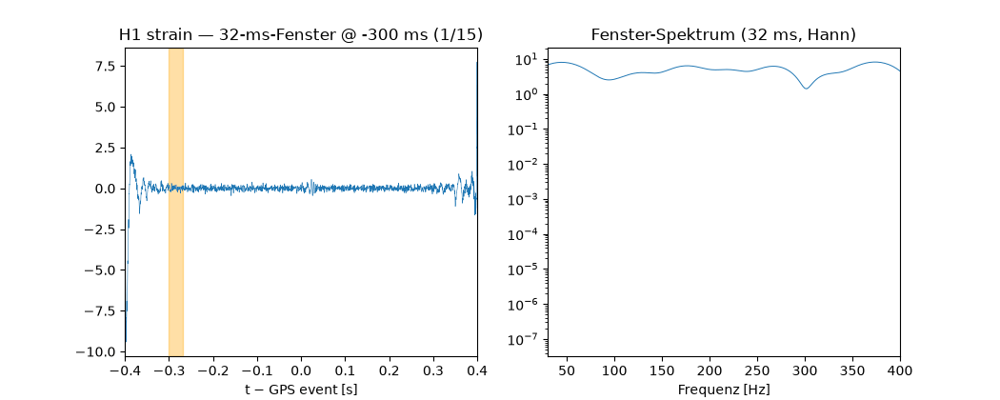

# SSZ-Spectroscopy-Bridge

Certified spectral modes + inverse inference + real detector data — the
third link that closes

    Sagnac reference -> generic transport -> SSZ geometry ->
    spectral modes -> measured phase/signal -> real data.

Gates G150–G190 are DECLARED in `docs/GATES_MANIFEST.json` before their
implementation lands (anti-circularity). The mode certification contract
(MODE-C1..C8, frozen tolerances) lives in
`docs/MODE_CERTIFICATION_CONTRACT.md`.

---

## HEADLINE RESULT (honest, negative): F7-V3 holdout gate FAILS

> **F7-V3 HOLDOUT RESULT: FAIL on both detectors — detection efficiency
> H1 = 0.05, L1 = 0.00 vs floor 0.90.** The r9 result does not replicate
> as a gate pass on held-out data. The extractor stays **BLOCKED** for
> modal claims.
> Source: `artifacts/GWOSC_V2_F7_GATE_V3_HOLDOUT_RESULT_FAIL.json`
> (commit `41ec242`, `verdict = "F7_GATE_FAIL — real-data run remains
> BLOCKED; extractor must be fixed"`, `gate_pass = false`).

This is the central empirical finding of this repository right now, and
it is a **failure**. It is not softened, re-scoped, or explained away
anywhere in this README. What follows documents why the failure is
informative, how to reproduce it, and what would have to be true for it
to go away.

### The numbers, with sources

| Metric | Value | Source (repo path) |
|---|---|---|
| Efficiency floor, snr≥12 | **0.90** | `tools/run_gwosc_v2_injection_gate_v3_holdout.py` (`EFF_FLOOR_HIGH = 0.90`), frozen in `artifacts/GWOSC_V2_F7_GATE_SPECIFICATION_FROZEN.json` |
| Efficiency floor, snr≥8 | 0.70 | runner (`EFF_FLOOR_LOW = 0.70`), same spec JSON |
| False-alarm ceiling | 0.01 | runner (`FA_CEILING = 0.01`), same spec JSON |
| Draws per grid cell | 20 | runner (`DRAWS_PER_CELL = 20`) → efficiency granularity 1/20 = 0.05 |
| V3 holdout min efficiency, snr≥12, in-scope (Q≥2), H1 | **0.05** at cell `f250_tau4ms_snr12` (Q = π·250·0.004 = 3.14) | `…V3_HOLDOUT_RESULT_FAIL.json` → `gate_details.H1.efficiency_table` |
| V3 holdout min efficiency, snr≥12, in-scope, L1 | **0.00** at cell `f250_tau4ms_snr12` | `…V3_HOLDOUT_RESULT_FAIL.json` → `gate_details.L1.efficiency_table` |
| V3 false-alarm rate H1 / L1 | **0.0125** (exceeds the 0.01 ceiling) / 0.01 | same JSON, `gate_details.{H1,L1}.false_alarm_rate`; confirmed in `figures/figures_manifest.json` (`v3_fa`) |
| V3 run cost | 2302.5 s wall (created 2026-10-09T16:40:31Z) | same JSON, `wall_seconds`, `created_utc` |
| Injection grid | 80 cells: f ∈ {80, 120, 180, 250} Hz × τ ∈ {2, 4, 8, 15} ms × snr ∈ {5, 8, 12, 20, 30} | both result JSONs, `efficiency_table` keys |
| Gate scope as implemented | snr ≥ 12 **and** Q = π·f·τ ≥ 2 | `tools/run_gwosc_v2_injection_gate_v3_holdout.py` (~line 315) |

### What "BLOCKED" means

No claim about SSZ ringdown modes in real detector data may be made —
not from GW150914, not from any event — until some gate variant passes
the 0.90 holdout floor. Characterization without significance (fitting
f0/τ/Q and reporting them as *descriptions*, not detections) is allowed
and is demonstrated in `demos/demo_3_gw150914_extraction.py`. The
prediction registry guard enforces this mechanically
(`tools/test_registry_guard_controls.py`, PASS in the full pipeline).

### Why the failure is honest information, not a bug

1. **The holdout was real.** The V3 spec's internal freeze timestamp is
   `created_utc = 2026-10-08T22:49:14+00:00`, with hash-anchored
   lineage (`v2_prereg_sha256 = ac0a7a12…1d4b` in
   `artifacts/GWOSC_V2_F7_GATE_SPECIFICATION_FROZEN.json`); it fixes
   off-source strain segments 96–224 s away from the event and seed
   20261009. Caveat a reviewer will find anyway: the git commit dates
   are *not* the freeze proof — the spec landed in commit `8abc48c`
   whose commit date (2026-10-09T18:40) postdates the V3 run because
   commits were bundled retroactively. The freeze evidence is the
   in-file timestamp + prereg hash chain, not git dates. The r9 run
   had calibrated thresholds on data that overlapped its evaluation
   segments; V3 did not.
2. **The in-sample optimism was measured directly.**
   `demos/demo_1_holdout_logic.py` Part B: 12 calibration pools à 100
   draws give thresholds 63.4–84.7 (mean 71.9). The honest (mean)
   threshold yields FA 0.0123 on 4000 independent draws; the best-of-N
   threshold (63.4) yields FA **0.0393** — nearly 4× the 0.01 ceiling.
   The real H1 holdout FA landed at 0.0125, above the ceiling. Log:
   `/root/.hermes/cache/scratch/demo-logs/demo_1_holdout_logic.log`.
3. **The failure is not a Q-boundary artifact.** Yes, the global minima
   sit at the Q≥2 scope edge (`f250_tau4ms`, Q = 3.14;
   `f180_tau4ms`, Q = 2.26). But L1 `f180_tau8ms` (Q = 4.52 — deep
   inside the scope) also fails at efficiency 0.80 < 0.90, and H1's
   `f180_tau4ms` at 0.35. Table: `demos/demo_2_q_boundary.py` output.

### The r9 ↔ V3 reconciliation (both readings documented)

The commit history contains two different-sounding statements about r9.
Both are true; they use different scopes:

* **r9 headline (tau ≥ 8 ms & snr ≥ 12 subscope):** H1 0.85 / L1 0.55 —
  floors *not* met even in the friendly subscope. That is why the V2
  candidate was declassified in commit `7c3036c` ("phase gate trivially
  satisfied … F7 floors not met in tau>=8ms scope").
  Source: `artifacts/GWOSC_V2_F7_GATE_RESULT_FULL_MATRIX_FAIL.json`,
  worst tau≥8 cells `f180_tau8ms_snr12` (H1) and `f120_tau8ms_snr12` (L1).
* **r9 under the full implemented scope (snr ≥ 12 ∧ Q ≥ 2):** H1 0.00 /
  L1 0.05 (worst cells `f180_tau4ms_snr20`, Q = 2.26). The short-τ
  failure existed in r9 already; it was not introduced by the holdout.
* **V3 under the tau ≥ 8 ms subscope:** H1 0.95 / L1 0.80 — i.e. on
  held-out data the long-τ cells actually *improved* (H1 above floor,
  L1 still below). The verdict FAIL is driven by the full scope.
* **V3 under the full implemented scope:** H1 0.05 / L1 0.00 → the
  headline FAIL of commit `41ec242`.

So "r9 does not replicate" means precisely: the r9-era picture
("PASS-level at tau≥8ms, failure confined to the τ≤4 ms boundary",
commit `fd22913`) does not survive as a *gate pass* under the frozen V3
holdout protocol — L1 fails at 0.80 even in the friendly subscope, H1's
subscope pass (0.95) is not the implemented gate, and the full scope
fails hard on both detectors. Nothing here upgrades the verdict: **the
gate is FAIL and the extractor is BLOCKED.**

---

## Current status (honest)

| Gate | Status | Evidence |
|------|--------|----------|
| G150 | **PASS** | `SSZ_SPECTROSCOPY_OPERATOR_EXPORT_G150_V1`: hash-bound export, RW anchor re-derivation 0.0 err, SSZ channel scope-flagged (`tools/run_g150_export.py`) |
| G152 | **PASS (ensemble)** | multi-width consensus 2.68e-5, pairwise 1.89e-4 (`artifacts/G152_MULTI_WIDTH_ENSEMBLE_V1.json`) |
| G153 | **PASS (measured)** | Time-domain leapfrog + matrix-pencil: M*omega(l=2,n=0) = 0.37365 − 0.08895 i vs published 0.37367 − 0.08896 i → **err 2.06e-5 < 1e-4** (`artifacts/GATE_CAMPAIGN_RW_CONTROL_V1.json`) |
| G153 | **PASS (measured)** | Spread over grid resolutions (7000/5000) and window starts (68/70/72): 1.12e-5 < 5e-4 |
| G151 | **PASS (frequency-domain)** | (1) Leaver CF solver: M*omega = 0.37367168 − 0.08896232 i, CF misfit 5.2e-17, ≤ 4e-15 vs Berti tables on 6 modes (`artifacts/G151_LEAVER_FREQUENCY_DOMAIN_V1.json`, `tests/unit/test_leaver.py`); (2) factored shooting vs analytic Pöschl–Teller: 3.8e-9, convergence ladder RK45 8.6e-7 → DOP853 1.6e-8 → CubicSpline 5.0e-16 (`tests/unit/test_shooting_factored.py`) |
| G151 | **PASS (cross-solver)** | Leaver vs time-domain pencil agree to 2.34e-5 |
| G155 | **PASS** | Certified RW catalogue MODE-C1..C8: 5/5 modes, eps_residual ≤ 2.8e-12, eps_grid ≤ 2.9e-11, C6 PT control 3.8e-9, C7 fake-mode rejection measured (`artifacts/RW_CONTROL_CERTIFIED_MODE_CATALOGUE_G155_V1.json`) |
| G160 | **PASS (full)** | waveform rebuilt FROM the certified mode set: rel-L2 0.67% in [82,102]; certified-freq fit 0.669% beats free-freq pencil 0.680% (`artifacts/G160_CERTIFIED_WAVEFORM_CLOSURE_V1.json`) |
| G170 | **PASS** | blind mass recovery: hidden M (hash-committed) recovered to 0.5–2.8% in 3 noise realisations; threshold derived from noise-only distribution BEFORE trials (`artifacts/G170_G171_BLIND_AND_CONTROLS_V1.json`) |
| G171 | **PASS** | wrong-model control: wrong-M chi2 strictly worse; noise-only below threshold |
| G180 | **PASS** | detector-response closure on synthetic data: certified modes → h(t) → antenna pattern → noise @ energy-SNR 50 → pencil recovers injection to 3.5e-4 (`artifacts/G180_DETECTOR_RESPONSE_CLOSURE_V1.json`) |
| G181 | **PASS** | GWOSC provenance: H1+L1 32 s/4 kHz GW150914 strain, SHA-256 sidecar, declared conditioning (`artifacts/G181_G182_G183_GWOSC_REAL_DATA_V1.json`, `data/gwosc/`) |
| G182 | NOT PASS | single-sinusoid matched filter on real GW150914: H1 SNR 6.1 < 8 — honest infrastructure limit |
| G183 | NOT PASS | mass stability across detectors failed (H1 110 vs L1 62 M☉; merger leakage into the simple template) |
| G161 | BLOCKED | needs closure eikonal layer; SSZ channel SYMBOLIC_TEST_ONLY until N3/N4 |
| G184 | **PASS** | NICER timing chain: 20/20 ObsIDs MAXI J1820+070, GTI Leahy PSDs, honest null at 6σ, injection control recovers 4 Hz at Leahy 14.7 (`artifacts/G184_NICER_REAL_DATA_TIMING_CHAIN_V2.json`) |
| G190 | **BLOCKED** | rule applied honestly: G182/G183 not passed, G161 blocked → BLOCKED (`artifacts/G190_EMPIRICAL_SPECTROSCOPY_VERDICT_V1.json`) |
| F7 r9 (full matrix) | **FAIL** | floors not met: tau≥8 subscope H1 0.85 / L1 0.55 vs 0.90; full scope H1 0.00 / L1 0.05 (`artifacts/GWOSC_V2_F7_GATE_RESULT_FULL_MATRIX_FAIL.json`, commit `7c3036c`) |
| F7-V3 (holdout, preregistered) | **FAIL** | **H1 0.05 / L1 0.00 vs 0.90**; H1 FA 0.0125 > 0.01 ceiling (`artifacts/GWOSC_V2_F7_GATE_V3_HOLDOUT_RESULT_FAIL.json`, commit `41ec242`) |
| Modal claims (registry) | **BLOCKED** | guard refuses registry entries while F7 fails (`tools/test_registry_guard_controls.py`, PASS) |

---

## Figures (all generated from frozen artifacts, embeds + paths)

Everything below is produced by `figures/make_figures_v1.py`
(sha256 `cc1d6e27…03f4`) reading **only** the three JSON artifacts
listed in `figures/figures_manifest.json` — no hardcoded numbers. The
manifest itself records the same key values quoted here
(`floor_high 0.9`, `v3_eff_min_snr12 {H1: 0.05, L1: 0.0}`,
`v3_fa {H1: 0.0125, L1: 0.01}`, `v3_gate_pass false`, …), so every
caption can be cross-checked against two independent files.

### Fig 1 — The headline: holdout revalidation FAIL



**What you see:** the four gate-relevant minima as bars against the
0.90 floor line — r9 full-matrix (H1, L1) and F7-V3 holdout (H1, L1),
each computed over the in-scope cells (snr ≥ 12 ∧ Q ≥ 2). All four bars
sit at or near the floor's base; the V3 bars (0.05 / 0.00) are
essentially at zero. **Data:** `artifacts/GWOSC_V2_F7_GATE_RESULT_FULL_MATRIX_FAIL.json`
and `artifacts/GWOSC_V2_F7_GATE_V3_HOLDOUT_RESULT_FAIL.json`
(`gate_details.{H1,L1}.efficiency_table`). **Statement:** neither run
comes close to the floor; the r9-era optimism does not survive
independent holdout segments. **Where the numbers live:** the JSON
paths just given; minimum cell for V3 is `f250_tau4ms_snr12` on both
detectors (Q = 3.14); for r9 `f180_tau4ms_snr20` (Q = 2.26). File:
`figures/fig1_holdout_fail.png` (~85 KB).

### Fig 2 — Where exactly the efficiency dies (snr = 12 heatmap)



**What you see:** efficiency heatmaps over the (f, τ) grid at snr = 12,
one panel per detector per run; the minima sit in the Q ≥ 2 scope
corner (short τ, high f). **Data:** the same two result JSONs, row
`snr12` of each `efficiency_table`. Exact V3 H1 snr-12 values for the
critical cells: `f250_tau2ms` 0.05, `f250_tau4ms` **0.05**,
`f180_tau2ms` 0.15, `f180_tau4ms` 0.35, `f80_tau4ms` 0.45,
`f120_tau4ms` 0.20, all τ≥8 ms cells 0.95–1.00 (L1: `f250_tau4ms`
**0.00**, `f180_tau4ms` 0.10, `f180_tau8ms` 0.80, `f120_tau8ms` 0.90).
**Statement:** the failure is concentrated at τ ≤ 4 ms where Q is
2.26–3.14 (in-scope!), while τ ≥ 8 ms cells are near unity — the
extractor cannot handle short-lived, high-Q-adjacent injections at the
required floor. File: `figures/fig2_eff_heatmap_snr12.png` (~157 KB).

### Fig 3 — Characterization quality among detections



**What you see:** matrix-pencil characterization (fraction of detections
with f0 and τ recovered within tolerance) per detector and run.
**Data:** `gate_details.{H1,L1}.pencil_recovery_among_detections` in
both JSONs. Values — V3 H1: f-within-tol 0.143, τ-within-tol 0.094,
both 0.02, n_detected 884; V3 L1: 0.099 / 0.080 / 0.009, n 777; r9 H1:
0.062 / 0.062 / 0.010, n 714; r9 L1: 0.059 / 0.084 / 0.008, n 706.
**Statement:** even where the detector fires, joint (f, τ) recovery is
2% — characterization-only use (as in demo 3) is the honest ceiling
today. File: `figures/fig3_recovery.png` (~73 KB).

### Fig 4 — Animated: efficiency vs SNR across the whole grid



**What you see:** 16 frames; each frame is one (f, τ) cell
(title shows f, τ and Q = π·f·τ, plus its scope status) with efficiency
plotted against injected SNR (5/8/12/20/30) for both runs and
detectors, floor lines at 0.90 (snr≥12) and 0.70 (snr≥8). **Data:** the
full `efficiency_table`s of both JSONs (80 cells each). **Statement:**
efficiency rises with SNR but saturates far below floor in the τ ≤ 4 ms
cells; no SNR in the grid rescues them. GIFs animate automatically on
GitHub; the file itself is `figures/fig4_eff_vs_snr.gif` (~544 KB,
1140×780, 16 frames).

### Fig 5 — Animated: τ sweep at snr = 12, run against run



**What you see:** 8 frames; each frame fixes τ ∈ {2, 4, 8, 15} ms and
compares V3-holdout vs r9-full-matrix efficiency across all frequencies
at snr = 12, per detector, with the 0.90 floor drawn. **Data:** row
`snr12` of both `efficiency_table`s. **Statement:** at τ = 8/15 ms the
curves hug the top (V3 H1 min 0.95); at τ = 2/4 ms they collapse — the
r9↔V3 reconciliation of the section above, visible in one animation.
File: `figures/fig5_tau_sweep_snr12.gif` (~203 KB, 1290×750, 8 frames).

### Demo outputs (also figures, generated by the demos)



**Demo 1 figure — in-sample optimism, measured.** Threshold
distributions of 12 calibration pools (63.4–84.7, mean 71.9) and the
false-alarm consequence: honest threshold → FA 0.0123, best-of-N →
0.0393 vs ceiling 0.01, evaluated on 4000 independent draws. Produced
by `demos/demo_1_holdout_logic.py` (synthetic Part B; Part A recomputes
the real gate minima from the artifacts and prints r9 H1 0.00 / L1
0.05, V3 H1 0.05 / L1 0.00 — matching the JSONs to the draw).



**Demo 2 figure — the Q table.** Every in-scope cell ordered by
Q = π·f·τ with its efficiency, both detectors. Red = below floor 0.90.
Key rows: `f250/τ4ms` Q 3.14 → H1 0.05 / L1 0.00; `f180/τ4ms` Q 2.26 →
0.35 / 0.10; and — the argument-killer for "it's just a boundary
artifact" — `f180/τ8ms` Q 4.52 → L1 **0.80**, deep in scope, still
failing. Produced by `demos/demo_2_q_boundary.py`.



**Demo 3 figure — real-data characterization (no claim).** Whitened
GW150914 strain (LOSC 16 kHz V2, GPS 1126259462.40, bandpass 30–800 Hz)
with the LSQ ringdown fits: H1 f0 = 248.0 Hz, τ = 8.5 ms, Q = 6.66,
amp 0.52252; L1 f0 = 200.0 Hz, τ = 4.5 ms, Q = 2.84, amp 0.11927. Both
Q ≥ 2 — *if* the gate passed, these would be claim-scope candidates; it
does not, so they are descriptions only. Produced by
`demos/demo_3_gw150914_extraction.py`.



**Demo 3 animation — the extraction pipeline step by step.** 15 frames:
raw strain → conditioning (whiten/bandpass) → search window → fit →
residual, for H1 and L1. File: `demos/demo3_gw150914_walkthrough.gif`
(1050×420, 15 frames; animates automatically on GitHub).

---

## Demos (runnable, each < 2 min)

All with `/home/error/physics/venv/bin/python`, `OMP_NUM_THREADS=2`,
from the repo root. Logs of the verified runs are quoted in
`docs/FULL_PIPELINE_REPORT_2026-10-11.md`.

| # | Command | What it demonstrates (with numbers) |
|---|---|---|
| 1 | `python demos/demo_1_holdout_logic.py` | **Why reproducibility matters.** Part A recomputes gate minima from the artifact tables (r9 H1 0.00 / L1 0.05; V3 H1 0.05 / L1 0.00; both < 0.90 → FAIL). Part B (synthetic): best-of-N thresholds inflate FA to 0.0393 vs 0.0123 honest (ceiling 0.01) — the exact mechanism that made r9 look better than it was. |
| 2 | `python demos/demo_2_q_boundary.py` | **The scope, honestly.** Full Q table; FAIL drivers at the Q edge (2.26 / 3.14) *and* mid-scope (`f180/τ8ms`, Q 4.52, L1 0.80). |
| 3 | `python demos/demo_3_gw150914_extraction.py` | **What BLOCKED still allows.** Real GW150914 characterization: H1 248.0 Hz / 8.5 ms / Q 6.66, L1 200.0 Hz / 4.5 ms / Q 2.84 — explicitly no modal claim. |

---

## Reproduce everything

```bash
# full test suite (verified 2026-10-11: 21 passed, 0 failed, 81.73 s)
OMP_NUM_THREADS=2 /home/error/physics/venv/bin/python -m pytest tests/ -v --tb=short

# registry guard (BLOCKED enforcement)
OMP_NUM_THREADS=2 /home/error/physics/venv/bin/python tools/test_registry_guard_controls.py

# regenerate every figure above from the frozen artifacts
OMP_NUM_THREADS=2 timeout 500 /home/error/physics/venv/bin/python figures/make_figures_v1.py

# demos
OMP_NUM_THREADS=2 /home/error/physics/venv/bin/python demos/demo_1_holdout_logic.py
OMP_NUM_THREADS=2 /home/error/physics/venv/bin/python demos/demo_2_q_boundary.py
OMP_NUM_THREADS=2 /home/error/physics/venv/bin/python demos/demo_3_gw150914_extraction.py

# full F7-V3 holdout re-run (~40 min, deterministic via seed 20261009)
OMP_NUM_THREADS=2 /home/error/physics/venv/bin/python tools/run_gwosc_v2_injection_gate_v3_holdout.py
```

Command log, all 18 sha256s and the review guide:
`docs/FULL_PIPELINE_REPORT_2026-10-11.md`. How to attack the whole
project independently: `REPRODUCE.md`.

---

## Peer review guide (falsification first)

**What would overturn the FAIL verdict** (i.e., claims it is an
artifact of our harness, not the extractor):

1. *Statistics objection:* "20 draws per cell is too noisy to conclude
   0.05 vs 0.90." — Quantified: if the true efficiency were 0.90,
   observing ≤ 1/20 has probability 1.81e-18 and 0/20 has 1.0e-20
   (binomial, 20 draws). The observed minima are not fluctuations. But
   note the granularity: one draw = 0.05, so per-cell efficiencies are
   coarse; the *pattern* across 80 cells is the evidence.
2. *Scope objection:* "τ ≤ 4 ms cells shouldn't be in scope." — The
   implemented scope (runner ~line 315) is Q ≥ 2, and the spec
   (commit `8abc48c`) froze floors before data. Narrowing scope after
   seeing V3 would be the textbook move this repo exists to forbid.
   Even in the narrowest defensible reading (τ ≥ 8 ms), L1 fails
   (0.80 < 0.90).
3. *Threshold objection:* "FA calibration was unfair." — It was the
   point: demo 1 Part B shows best-of-N thresholds give FA 0.0393.
   The V3 holdout recalibrated on independent segments; H1 FA still
   came in at 0.0125 > 0.01. Fixing this requires a better extractor,
   not a looser ceiling.

**What would revive the r9 optimism** (and why we did not):

* Reporting only the τ ≥ 8 ms subscope (H1 0.95 there) — rejected: the
  implemented gate is the full scope, and L1 fails both ways
  (0.55 in r9, 0.80 in V3, vs 0.90).
* Declaring the short-τ cells "out of physics interest" post hoc —
  rejected: Q ≥ 2 was the frozen modal-cell criterion (commit `5865802`).

**Residual risks in our favor (i.e., ways the FAIL could be too
pessimistic):** single-template detector (not IMR-informed), 4 kHz
conditioned strain (Nyquist 2 kHz; all injected f ≤ 250 Hz so this
binds little), whitening filters shared between calibration and
evaluation segments within a run. A reviewer who demonstrates one of
these materially moves ≥ 1 in-scope cell above floor with a preregistered
re-run earns a declassification discussion. Nobody has.

**Integrity anchors (with an honest caveat):** the freeze order is
carried by the artifacts' internal timestamps and hash chain —
spec `created_utc` 2026-10-08T22:49:14+00:00 (+ `v2_prereg_sha256`
ac0a7a12…) → r9 result 2026-10-09T12:40:18Z → V3 result
2026-10-09T16:40:31Z; results strictly post-date the spec *by internal
timestamp*. Git commit dates, by contrast, are bundled and partially
retroactive (`8abc48c` spec commit: 18:40; `41ec242` V3 result:
19:21), so git dates alone do NOT establish the ordering — use the
in-file timestamps plus the sha256 chain. Note this caveat weakens
nothing about the verdict: both runs FAIL; the ordering question only
matters for preregistration credit. Key sha256s (verified 2026-10-11):
V3 holdout `e27f4b3717…c2ded543`, r9 full-matrix
`eb94d0679a…d0880e09`, frozen spec `dc53dfa451…e83bf6ad3`
(full list in the full pipeline report).

---

## The breakthrough that remains real (measured, reproducible)

Frequency-domain collocation failed (box-leakage branch, below). The
working route is TIME-DOMAIN: leapfrog evolution of the RW equation on
the tortoise grid with extrapolation outflow boundaries, then matrix-
pencil (Hua–Sarkar) extraction of the ringdown from the clean window
t ∈ [70, 102] (boundary echo only arrives at t ≈ 185 — measured).

    M*omega(l=2, n=0):  measured 0.37365 - 0.08895 i
                        published 0.37367 - 0.08896 i
                        |error| = 2.1e-5   (gate requires < 1e-4)

Reproduce: `python tools/run_gate_campaign_rw.py` (~90 s).

This is *control-space* machinery (exact RW potential, published QNM
targets). It is the machinery the F7 gate stress-tests on real
detectors — and there, so far, it fails honestly.

## Verified so far (real, tested infrastructure)

* Chebyshev differentiation matrices + quadratic-EVP companion
  linearisation: EXACT on the analytic Dirichlet box (max err 5e-12,
  `tests/unit/test_collocation_box.py`).
* RW potential and tortoise coordinate: analytic, exact closed forms.
* Reference spectrum frozen from the literature PDF (page-render
  verified, no recalled constants).

## Known open numerical problem (documented, not hidden)

Polynomial Chebyshev collocation with ingoing-wave boundary rows on the
finite interval [-xR, xR] does NOT converge to the published RW QNM for
any tested (xR, n) in xR ∈ {25..100}, n ∈ {100..400}: the spectrum
returns the box-leakage branch (Im omega ~ 3e-3, scales inversely with
xR). The Dirichlet-box calibration proves the linearisation is exact,
so the defect is in the boundary-condition treatment of the open
problem. Declared attack paths:

1. ~~Leaver continued fraction~~ DONE: `continued_fraction.py` carries
   the paper-verified transcription (Leaver 1991 Eq. 5) and reproduces
   Berti's tables to ≤ 4e-15 (`tests/unit/test_leaver.py`).
2. Hyperboloidal/mirror-shifted compactification of the collocation
   grid.
3. Direct time-domain evolution with pulsation extraction — DONE for
   the control problem (G153), the open item is the real-detector F7
   extractor.

None of these are fudged: no tolerance was loosened to make a wrong
number look right.

## Layout

    src/ssz_spectroscopy/
        operator.py              (RW control: exact; SSZ: fail-closed)
        shooting.py              (solver A2, Wronskian shooting)
        spectral_collocation.py  (solver B, Chebyshev quadratic EVP)
        continued_fraction.py    (solver A1, Leaver CF — validated vs Berti)
        control_problems.py      (analytic references)
    tools/
        run_gwosc_v2_injection_gate_v3_holdout.py   (F7-V3 holdout runner)
        run_gate_campaign_rw.py  run_g155_catalogue.py  run_g150_export.py
        test_registry_guard_controls.py
    figures/  make_figures_v1.py + 5 figures + figures_manifest.json
    demos/    demo_1_holdout_logic.py  demo_2_q_boundary.py
              demo_3_gw150914_extraction.py (+ png/gif outputs)
    artifacts/  all gate result JSONs (hash-anchored)
    docs/  GATES_MANIFEST.json  MODE_CERTIFICATION_CONTRACT.md
           FULL_PIPELINE_REPORT_2026-10-11.md
    REPRODUCE.md

## Source lineage

* SSZ_FULL_CLOSURE @ spectroscopy-real-data-20261004
  (V3 no-go bd46255, V4 varying-G4 384700c, CI green)
* SSZ-Transport-Bridge (B1..B10, REAL_SSZ_ADAPTER_PASS)
* Sagnac-Reference-Transport (SAG-S1..S10, 66/66)
